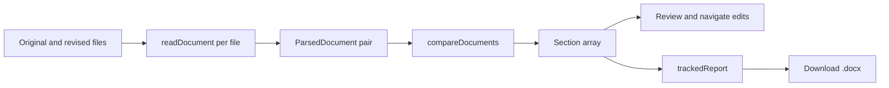

# Diff Tool architecture

This guide follows the implementation at `969f223` on `feature/document-comparison`. A Word document selected in **Documents** goes through a TypeScript parser and redline engine on the user's device. The same file passed to `dt office diff` goes through a Rust adapter and produces structured JSON. A fix in one engine can leave the other path unchanged. To run both against the same pair of files, follow the [developer walkthrough](development.md#compare-the-same-word-pair-in-two-runtimes).

## Where a comparison runs

| User action | Execution path | Result consumed by the caller |
| --- | --- | --- |
| Open files in **Documents** | React file inputs → `readDocument` → `compareDocuments` | `Section[]` with word spans, optional moves, and section status. The UI and tracked Word writer both consume it. [Document review](../apps/desktop/src/documents/DocumentReview.tsx) |
| Compare rendered pages of two PDFs | PDF.js renders each page pair to canvases. A pixel comparison emits each result as it finishes. | `VisualPage` with page number, status, and an optional preview image. [Page comparison](../apps/desktop/src/documents/pdfVisual.ts) |
| Open two plain-text files in the browser's **Changes** view | The browser reads the selected files. Pierre compares the two strings and renders their hunks. | Pierre's `FileDiffMetadata`. [File loader](../apps/desktop/src/useFileDiffLoader.ts) |
| Open two native file paths in **Changes**, or run `dt diff` | The desktop calls Tauri's `compare_files`. The CLI calls the same Rust core directly. | `DiffResult` with files, hunks, statistics, warnings, and truncation state. [Rust core](../crates/diff-core/src/lib.rs) · [Native renderer](../apps/desktop/src/components/NativeDiffRenderer.tsx) |
| Scan or compare desktop folders | The tree loader calls `scan_tree` for one root and `compare_folders` for two. The browser demo supplies a sample tree. | Relative paths and entry status. Selecting a file hands its paths to the file loader. [Tree loader](../apps/desktop/src/useTreeLoader.ts) · [Filesystem adapter](../crates/git-adapter/src/lib.rs) |
| Run `dt office diff` or invoke Tauri's `compare_office` | The Rust Office adapter opens paths and dispatches to the Word, Excel, or PowerPoint implementation. | `OfficeDiffResult` with a summary, sections, atomic changes, warnings, and unsupported features. [Office adapter](../crates/office-adapter/src/lib.rs) · [Rust result types](../crates/office-adapter/src/models.rs) |

React selects the view in `App.tsx`. In a browser, opening or dropping a Word, Excel, PowerPoint, or PDF file routes the pair to Documents. Two text files stay in Changes unless Documents is already selected. In the desktop shell, the Documents toolbar uses HTML file inputs, while native drag-and-drop handles filesystem paths. Follow the entry point that reproduced a bug. [App routing](../apps/desktop/src/App.tsx) · [IPC client](../apps/desktop/src/tauri.ts) · [Registered Rust commands](../apps/desktop/src-tauri/src/main.rs)

Local document comparison reads the files on the device. PDF.js and English OCR load their worker and model assets from the app. GitHub Review can fetch PR or commit data from GitHub, and the optional AI adapter can send an explicit analysis request to its configured provider. Those calls have separate entry points. [OCR asset loading](../apps/desktop/src/documents/ocr.ts) · [GitHub Review](../apps/desktop/src/components/GitHubReview.tsx) · [AI adapter](../crates/ai-adapter/src/lib.rs)

## How the native text path differs

The CLI builds a `DiffRequest` from flags. Tauri builds one from its IPC request and can emit `diff-progress` events. The Rust core reads the paths, detects binary input, normalizes line endings, applies the requested ignore mode, and groups line changes into hunks with context. For ordinary line diffs it also marks character changes inside adjacent deleted and inserted lines. The native renderer consumes this result directly. Callers must inspect `warnings` and `truncated` alongside the hunks. For example, an expired computation deadline can produce empty hunks with a warning. [Rust text pipeline](../crates/diff-core/src/lib.rs) · [Tauri request defaults](../apps/desktop/src-tauri/src/main.rs) · [CLI flags](../crates/diff-cli/src/main.rs)

A two-folder comparison joins entries by relative path. It can identify a modified file from size alone and reads equal-size files in chunks to compare their bytes. Selecting an added or deleted file opens a one-sided preview. This explains why the tree can identify a changed binary even when the text renderer cannot open it. [Folder comparison](../crates/git-adapter/src/lib.rs) · [Preview handling](../apps/desktop/src/useFileDiffLoader.ts)

## From two Word files to a tracked report

**1. Read the current pair.** `DocumentReview` starts both reads together. A component-local `WeakMap` caches successful parses by `File` identity. Replacing the revision reuses the selected original, including its OCR text. A different file with the same name gets a fresh parse. Changing the pair signals cancellation and prevents an older result or error from replacing the current review. [Review lifecycle](../apps/desktop/src/documents/DocumentReview.tsx)

**2. Give comparable content a stable name.** A `ParsedDocument` contains a format and an ordered `Map<string, string>` of sections. The map key identifies the section across versions and labels it in the UI. The Word reader walks runs in document order, includes table text once, and reads existing tracked edits in their revised state. It puts direct formatting, table structure, and header or note text into additional sections. Excel keys cells by sheet and address, with distinct entries for formulas. PowerPoint keys slide text by presentation position. Same-format Office pairs also compare embedded media bytes by package path. [Format readers](../apps/desktop/src/documents/read.ts) · [Section and media comparison](../apps/desktop/src/documents/redline.ts)

**3. Align the text.** For two multi-paragraph Word bodies, the engine first tries to pair paragraphs in order. Both sides must have the same paragraph count, each edited pair must share a substantial prefix or suffix, and an exact match elsewhere takes priority. Otherwise, unchanged paragraph blocks anchor word comparison in the gaps. A unique, identical paragraph removed in one position and added in another can receive a move annotation. Repeated or edited paragraphs can appear as ordinary additions and deletions. [Paragraph alignment and moves](../apps/desktop/src/documents/redline.ts)

**4. Preserve both readings.** Each span carries text and an optional added or removed flag. Skipping additions must reconstruct the original comparison text. Skipping deletions must reconstruct the revision. The engine checks word alignment against both strings and retries with whitespace-sensitive matching when needed. The word comparison has a 1,500 ms budget per modified section. If a gap exhausts that budget, it records the old and new text as a replacement. This preserves both readings at the cost of a coarser redline. [Span construction](../apps/desktop/src/documents/redline.ts) · [Round-trip tests](../apps/desktop/src/documents/redline.test.ts)

**5. Review or export.** React renders deletions and insertions from those spans. `trackedReport` serializes them as WordprocessingML revisions in a new DOCX package. The writer receives all sections, including ones hidden by the review filter. The export preserves comparison text, adds labels for auxiliary sections, and represents media changes with descriptions. Recreating source pagination, styles, and embedded objects would require a richer model. Printing uses the visible review. [Review controls](../apps/desktop/src/documents/DocumentReview.tsx) · [DOCX writer](../apps/desktop/src/documents/redline.ts)

The HTML review report uses the same comparison result. Text mode turns spans and detected moves into a summary and before-and-after excerpts. Visual PDF mode waits until the current pair finishes, then embeds the page previews in the download. The shared writer creates a standalone document with embedded styles. The Pages build saves three fictional example reports from the browser tests that validate them. [Text report](../apps/desktop/src/documents/textReport.ts) · [Visual report](../apps/desktop/src/documents/visualReport.ts) · [HTML writer](../apps/desktop/src/documents/reviewReport.ts)

## Where the evidence stops

| Boundary | Consequence for review |
| --- | --- |
| PDF text and OCR | Any pair containing a PDF compares body text with whitespace collapsed. PDF.js supplies reading order. An image-only, nonblank page triggers English OCR. A page with some extractable text can still contain image text that is missed. [PDF reader](../apps/desktop/src/documents/pdf.ts) |
| PDF appearance | Visual mode pairs pages by index and caps the long edge at 1,400 pixels. An inserted page can shift all subsequent comparisons. Word-level agreement gives no evidence about pixel alignment. [Visual comparison](../apps/desktop/src/documents/pdfVisual.ts) |
| Resource limits | The text reader rejects files over 50 MiB. The Office unpacker allows up to 12,000 entries and caps selected parts at 16 MiB each and 64 MiB in total. These are text-reader limits. PDF visual mode opens its file inputs separately. [Package reader](../apps/desktop/src/documents/read.ts) |
| Litera agreement | On 131 eligible lines reconstructed from two published redlines, 104 matched every marked word position and 27 differed. The separate 1,500-clause speed benchmark measures comparison after parsing. Source-layout fidelity still requires separate validation. [Corpus, scores, timings, and reproduction](document-comparison.md) |

## Decisions for review

- **Export fidelity.** Is a tracked report containing extracted text the deliverable, or must a reviewer accept changes inside a document that retains the original styles, numbering, and page layout? The latter would require tracking the source XML locations behind each edit.
- **Browser and CLI consistency.** Which outcomes must both implementations agree on? The shared Word fixture is a starting point. A cross-runtime acceptance test could compare changed passages even though the browser emits spans and Rust emits atomic changes.
- **Large-document responsiveness.** OCR has a worker, while Office unpacking and word alignment run synchronously in the UI context. If responsiveness is a release criterion, measure input-to-first-result time and UI stalls on representative files alongside the existing engine benchmark.
